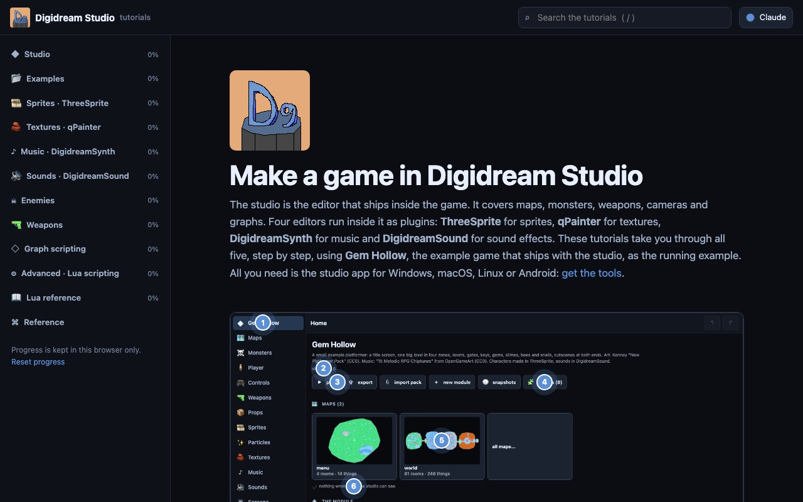

# Digidream Studio tutorials

Interactive tutorials for Digidream Studio and its four plugin editors:
ThreeSprite (sprites), qPainter (textures), DigidreamSynth (music) and
DigidreamSound (sound effects). They go step by step, using the example games
that ship with the studio, and include small live demos, quizzes, shortcut
trainers and a Lua playground. A Lua reference and a glossary are included.



## Read them

- **Online:** [projectdigidream.github.io/digidream-website/tutorials/](https://projectdigidream.github.io/digidream-website/tutorials/),
  part of the Digidream website.
- **Offline:** download `digidream-tutorials-<version>-site.zip` from
  [github.com/projectdigidream/digidream-tutorials/releases/latest](https://github.com/projectdigidream/digidream-tutorials/releases/latest),
  unzip it, and open `tutorials/index.html` in a browser.

Opened straight from disk, search only matches page titles, because full-text
search needs to fetch the pages over HTTP. To get full search, serve the folder,
for example:

```sh
python3 -m http.server -d tutorials 8970   # then open http://localhost:8970/
```

The pages need nothing from the internet. The steps you tick are remembered in
your own browser (localStorage); nothing is sent anywhere. The skin button in
the top bar changes the look; **Auto** follows your system's light or dark
setting.

## Host them

The site is static: plain HTML, CSS and JavaScript, with no build step and no
server code. All links are relative, so it works under any path, on any static
host (GitHub Pages, Netlify, Cloudflare Pages, S3, nginx). Serve this folder as
it is.

## Development

To add or change a page, see [AUTHORING.md](AUTHORING.md).

### What's inside

- `index.html`: the landing page and learning paths.
- `studio/`, `examples/`, `sprites/`, `textures/`, `music/`, `sounds/`,
  `enemies/`, `weapons/`, `graphs/`, `advanced/` (Lua scripting), `luaref/`
  (the Lua reference): the tracks. Each track folder's `index.html` is that
  track's overview page.
  - `examples/` holds guided tours of the two example projects bundled with the
    studio (Home > examples): Gem Hollow and Cinderfall.
- `reference/`: all shortcuts, files and baking, and a glossary.
- `assets/site.css`, `assets/site.js`: the shell (sidebar, search, progress,
  quizzes, shortcut trainers, screenshot hotspots).
- `assets/nav.js`: the table of contents. `assets/shortcuts.js`: every shortcut.
- `assets/widgets/`: the interactive demos (room drawing, sprite views, seamless
  tile painter, ADSR synth, cue timeline, SFX toy, graph toy...).
- `assets/shots/`: screenshots of the real tools.
- `assets/vendor/fengari-web.js`: [fengari](https://fengari.io), a Lua VM in
  JavaScript (MIT, see `fengari-LICENSE.txt`). The Lua playground in
  `advanced/` runs on it, against a toy world that answers to the engine's
  function names.
- `assets/logo.png`: the Digidream logo.

### Generated files, and the repositories they come from

Three tools in `tools/` regenerate or check files against other Digidream
repositories. They expect those checked out beside this one, under these folder
names:

```sh
git clone https://github.com/projectdigidream/digidream-tutorials.git tutorials
git clone https://github.com/projectdigidream/digidream-engine.git engine
git clone https://github.com/projectdigidream/digidream-uikit.git uikit
```

They need Node, and are run from the folder that holds all three:

```sh
node tutorials/tools/build-vocab.mjs     # assets/data/vocab-*.js, from engine/maps/scripts
node tutorials/tools/check-lua-ref.mjs   # exits 1 and names what is missing or gone
node tutorials/tools/build-skins.mjs     # assets/skins/, from uikit/skins
```

- `assets/data/vocab-*.js` hold the engine's graph, monster and weapon
  vocabularies, behind the generated reference pages. Don't edit them; run
  `build-vocab.mjs` after the engine's vocabulary changes.
- The Lua reference (`luaref/`) is hand-written data in
  `assets/data/lua-api-world.js` (the engine's bindings) and
  `assets/data/lua-api-libs.js` (the runtime libraries). `check-lua-ref.mjs`
  checks it against the engine's source: every name a script can reach must be
  documented or listed as internal. Run it after the engine changes.
- `assets/skins/` holds the five skins uikit ships (claude, paper, 90s, ps1,
  aero), compiled by uikit's own compiler. Run `build-skins.mjs` after a skin
  changes.

## Licence

MIT, see LICENSE. Third-party parts keep their own licences: THIRD_PARTY.md.
